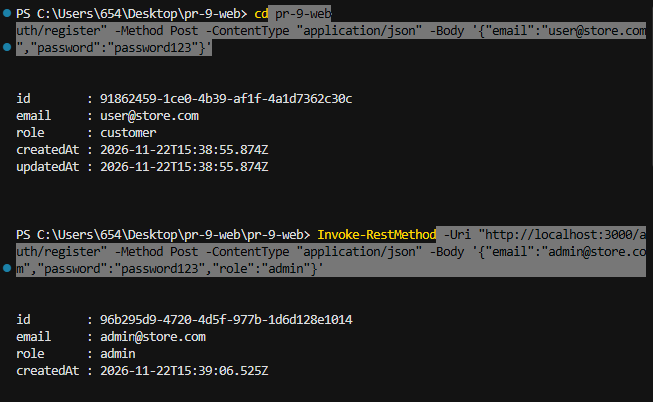
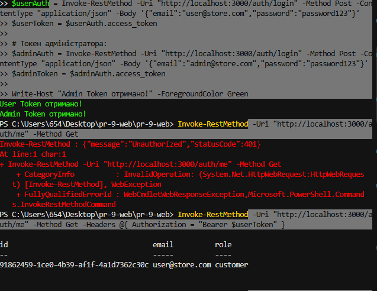
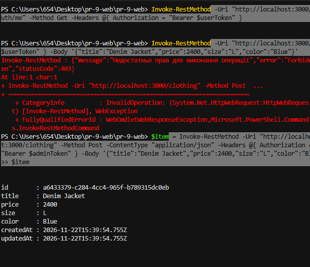

# Практична робота № 9
## Тема: Автентифікація користувачів (JWT, Passport), кастомні декоратори та рольовий контроль доступу (RBAC) у NestJS

**Виконала:** Тирканич Корнелія, група КН-41

---

## Мета роботи

Опанувати принципи побудови системи автентифікації на основі JSON Web Tokens (JWT) та бібліотеки Passport у фреймворку NestJS, навчитися безпечно зберігати паролі за допомогою хешування `bcrypt`, розробляти власні декоратори (`@CurrentUser`, `@Public`, `@Roles`) та глобальні охоронці (`JwtAuthGuard`, `RolesGuard`) для розмежування прав доступу між покупцями та адміністраторами інтернет-магазину.

## Індивідуальний варіант № 3

**Домен: Інтернет-магазин одягу**

- Базова сутність каталогу: `ClothingEntity` — одяг.
- Сутність користувача: `UserEntity` — користувач системи.
- Таблиця користувачів: `users`.
- Маршрути каталогу: `/clothing`.

**Ролі доступу:**
- `CUSTOMER` (`customer`) — звичайний покупець.
- `ADMIN` (`admin`) — адміністратор каталогу.

---

# 1. Хід виконання роботи

## 1.1. Створення сутності користувача та модуля автентифікації

У межах проєкту `pr-9-web` створено модуль користувачів `UsersModule` та сутність `UserEntity` для роботи з базою даних PostgreSQL `store_pr9_db`.

Сутність користувача містить такі поля:

| Поле | Тип / призначення |
|---|---|
| `id` | UUID, первинний ключ |
| `email` | Унікальна електронна пошта |
| `passwordHash` | Хеш пароля користувача |
| `role` | Роль користувача |
| `createdAt` | Дата створення запису |
| `updatedAt` | Дата останнього оновлення |

Для визначення прав доступу створено перелічуваний тип `Role`:

```typescript
export enum Role {
  CUSTOMER = 'customer',
  ADMIN = 'admin',
}
```

За замовчуванням новим користувачам призначається роль `Role.CUSTOMER`.

Також створено `AuthModule` із використанням бібліотек `@nestjs/jwt` та `@nestjs/passport`.

Для підпису JWT-токенів налаштовано секретний ключ та час життя токена — `1h`.

## 1.2. Реєстрація та вхід користувачів

У `AuthService` та `AuthController` реалізовано два основні ендпоінти:

### Реєстрація користувача — POST /auth/register

Для реєстрації реалізовано:

- перевірку правильності електронної пошти за допомогою `@IsEmail()`;
- перевірку мінімальної довжини пароля через `@MinLength(6)`;
- перевірку унікальності електронної пошти;
- обробку дублювання через `ConflictException`;
- хешування пароля за допомогою `bcrypt`;
- збереження користувача з базовою роллю `customer`.

Приклад хешування пароля:

```typescript
const passwordHash = await bcrypt.hash(password, 10);
```

Кількість раундів соління становить 10.

Після успішної реєстрації повертається профіль користувача без поля `passwordHash`.

### Авторизація користувача — POST /auth/login

Під час входу в систему виконується пошук користувача за електронною поштою та перевірка введеного пароля.

```typescript
const isPasswordValid = await bcrypt.compare(
  password,
  user.passwordHash,
);
```

Якщо облікові дані неправильні, повертається:

```typescript
throw new UnauthorizedException('Невірні облікові дані');
```

Після успішної перевірки генерується JWT Access Token.

Приклад корисного навантаження (Payload):

```typescript
{
  sub: user.id,
  email: user.email,
  role: user.role,
}
```

Токен використовується для ідентифікації користувача та перевірки його прав доступу до захищених маршрутів.

## 1.3. Реалізація JWT-стратегії Passport

Для перевірки токенів створено `JwtStrategy` на основі бібліотеки `passport-jwt`.

Стратегія виконує такі дії:

1. Отримує JWT із заголовка HTTP-запиту `Authorization`.
2. Перевіряє цифровий підпис токена за допомогою секретного ключа.
3. Перевіряє термін дії токена.
4. Передає дані авторизованого користувача до об'єкта `request.user`.

Для передавання токена використовується формат:

```http
Authorization: Bearer YOUR_ACCESS_TOKEN
```

Таким чином, Passport забезпечує перевірку автентичності користувача перед виконанням захищених операцій.

## 1.4. Створення кастомних декораторів

Для спрощення керування доступом створено три власні декоратори.

### Декоратор @Public()

Використовується для позначення маршрутів, які доступні без авторизації.

```typescript
import { SetMetadata } from '@nestjs/common';

export const Public = () => SetMetadata('isPublic', true);
```

Застосовується до відкритих маршрутів, наприклад перегляду каталогу одягу.

### Декоратор @CurrentUser()

Створений за допомогою `createParamDecorator`.

Дозволяє отримувати інформацію про поточного авторизованого користувача або окреме поле його профілю без безпосереднього звернення до об'єкта `request`.

Використовується, зокрема, в ендпоінті `GET /auth/me`.

### Декоратор @Roles()

Визначає ролі, яким дозволено виконувати певний маршрут.

```typescript
import { SetMetadata } from '@nestjs/common';
import { Role } from '../users/entities/role.enum';

export const Roles = (...roles: Role[]) =>
  SetMetadata('roles', roles);
```

Наприклад:

```typescript
@Roles(Role.ADMIN)
```

Цей декоратор дозволяє обмежити доступ до операцій керування каталогом виключно адміністраторами.

## 1.5. Реалізація глобальних охоронців (Guards)

Для централізованого захисту маршрутів застосунку підключено два глобальні охоронці через `APP_GUARD`.

### JwtAuthGuard

Відповідає за перевірку автентифікації користувача.

Основні функції:

- перевірка наявності JWT-токена;
- перевірка його валідності;
- блокування неавторизованих запитів;
- пропуск маршрутів, позначених декоратором `@Public()`.

Якщо користувач не передав токен або він недійсний, сервер повертає `401 Unauthorized`.

### RolesGuard

Відповідає за перевірку ролей користувача.

Для отримання метаданих маршрутів використовується `Reflector`.

Охоронець порівнює роль користувача з дозволеними ролями маршруту.

Якщо прав недостатньо, генерується:

```typescript
throw new ForbiddenException(
  'Недостатньо прав для виконання операції',
);
```

У результаті користувач із роллю `customer` не може виконувати адміністративні операції.

## 1.6. Захист каталогу товарів інтернет-магазину

Для ресурсу `/clothing` налаштовано розмежування доступу залежно від ролі користувача.

| HTTP-метод | Маршрут | Доступ |
|---|---|---|
| GET | `/clothing` | Публічний |
| GET | `/clothing/:id` | Публічний |
| POST | `/clothing` | Тільки ADMIN |
| PATCH | `/clothing/:id` | Тільки ADMIN |
| DELETE | `/clothing/:id` | Тільки ADMIN |

Публічні маршрути позначено декоратором:

```typescript
@Public()
```

Для операцій створення, редагування та видалення товарів використовується:

```typescript
@Roles(Role.ADMIN)
```

Таким чином, усі відвідувачі можуть переглядати асортимент магазину, але змінювати каталог можуть лише адміністратори.

---

# 2. Результати тестування системи безпеки

Після запуску NestJS-сервера за допомогою команди:

```powershell
npm run start:dev
```

Було виконано тестування автентифікації та рольового контролю доступу за допомогою HTTP-запитів.

## 2.1. Перевірка реєстрації та авторизації

| Ендпоінт | Умови запиту | Результат |
|---|---|---|
| `POST /auth/register` | Новий email без токена | `201 Created` |
| `POST /auth/login` | Правильні email та пароль | `201 Created` |
| `GET /auth/me` | Без токена | `401 Unauthorized` |
| `GET /auth/me` | Токен CUSTOMER | `200 OK` |

Під час реєстрації користувача `user@store.com` було успішно створено обліковий запис із роллю `customer`.

Поле `passwordHash` не повертається у відповіді API.

Після входу в систему було отримано JWT Access Token, який використовувався для подальших авторизованих запитів.

## 2.2. Перевірка рольового контролю доступу (RBAC)

| Ендпоінт | Роль користувача | Очікуваний статус | Результат |
|---|---|---|---|
| `GET /clothing` | Без токена | `200 OK` | Успішно |
| `POST /clothing` | CUSTOMER | `403 Forbidden` | Заблоковано |
| `POST /clothing` | ADMIN | `201 Created` | Успішно |
| `DELETE /clothing/:id` | CUSTOMER | `403 Forbidden` | Заблоковано |

Під час перевірки встановлено, що:

- покупець може переглядати каталог;
- покупець не може створювати товари;
- покупець не може видаляти товари;
- адміністратор може створювати нові товари;
- захищені маршрути потребують валідного JWT-токена.

У результаті перевірки підтверджено правильність роботи `JwtAuthGuard` та `RolesGuard`.

## 2.3. Скріншоти тестування











---

# 3. Висновки

У ході виконання практичної роботи № 9 було реалізовано систему автентифікації та рольової авторизації (RBAC) для бекенд-застосунку інтернет-магазину одягу на базі NestJS, Passport та PostgreSQL.

Було створено сутність користувача `UserEntity`, налаштовано модулі `UsersModule` та `AuthModule`, реалізовано реєстрацію і вхід користувачів із використанням безпечного хешування паролів за допомогою `bcrypt`.

Також було налаштовано генерацію JWT Access Token, створено `JwtStrategy` для перевірки токенів та реалізовано кастомні декоратори `@Public()`, `@CurrentUser()` і `@Roles()`.

Для централізованого керування доступом підключено глобальні охоронці `JwtAuthGuard` та `RolesGuard`, які забезпечують перевірку автентифікації та ролей користувачів.

У результаті реалізовано розмежування прав доступу між покупцями та адміністраторами: перегляд каталогу доступний усім відвідувачам, а створення, редагування та видалення товарів дозволено виключно адміністраторам.

Під час тестування підтверджено коректну роботу реєстрації, авторизації, перевірки JWT-токенів та обмеження доступу до адміністративних операцій.

---

**Технології:** TypeScript, NestJS, Node.js, TypeORM, PostgreSQL, Passport, JWT, bcrypt.